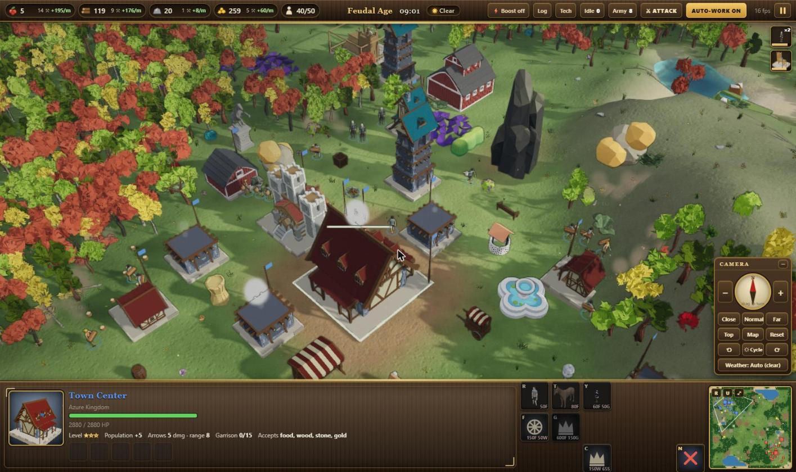
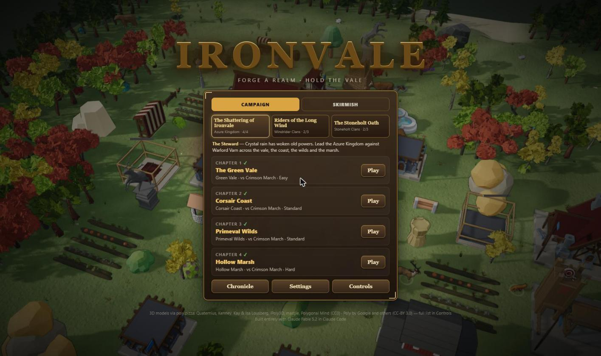
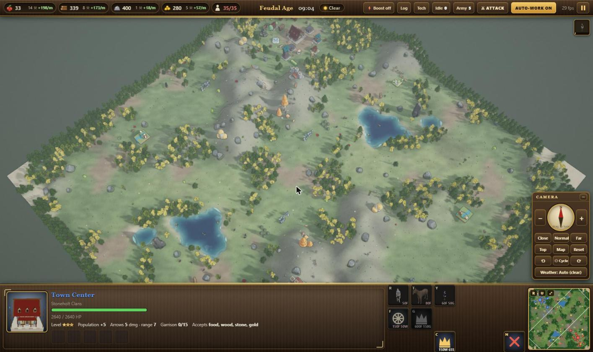
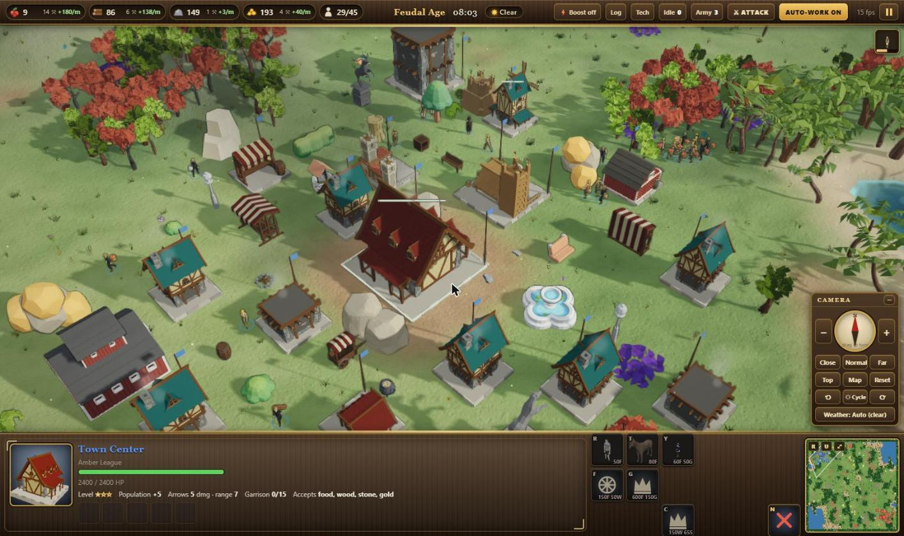
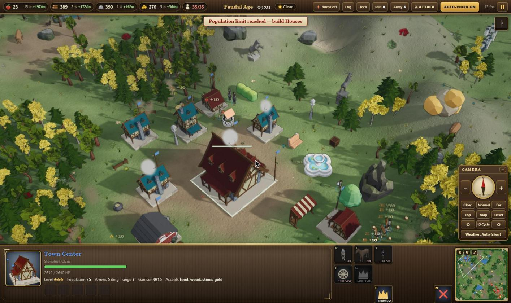
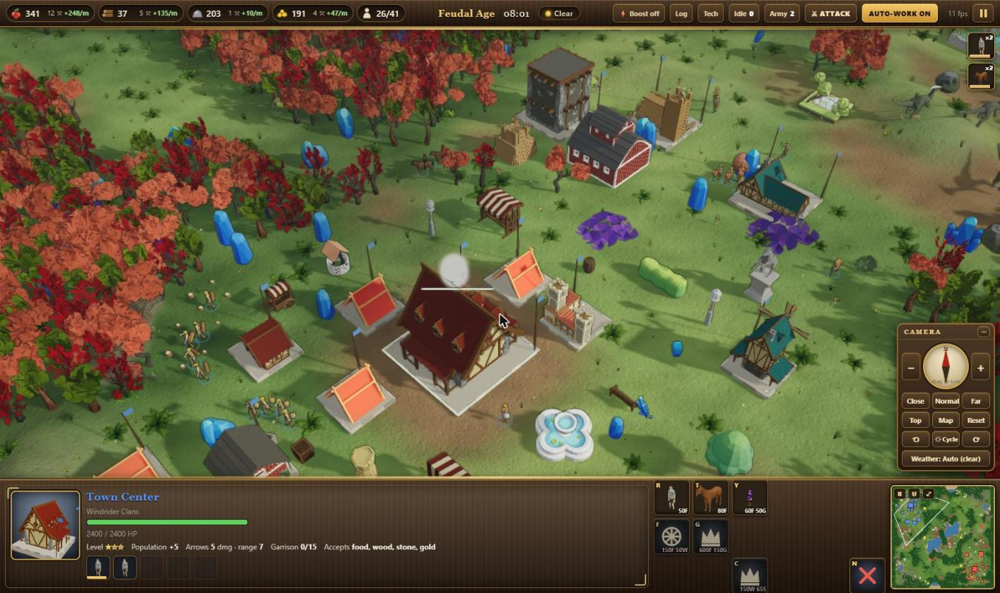
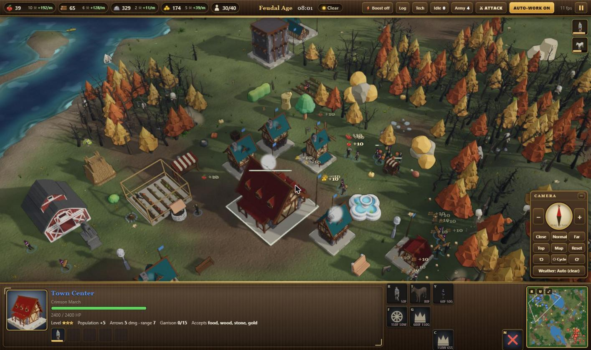

# Ironvale: a game made with AI (Claude Fable 5.2)

A 3D real-time strategy game for the browser: gather, build, advance through three ages and defeat the Crimson March. Play the four-chapter story campaign **The Shattering of Ironvale**, or a skirmish on one of five map types (Green Vale, Iron Highlands, Corsair Coast, Primeval Wilds, Hollow Marsh) in four sizes (Small 96² to Huge 200²).

**Play in your browser:** https://sharpwizard.github.io/ironvale/

**Windows:** download `Ironvale.exe` from the [latest release](https://github.com/SharpWizard/ironvale/releases/latest). One portable file, works offline.

**From source:** open `ironvale.html` (keep the `models/` and `lib/` folders next to it). Works fully offline; three.js r128 is bundled in `lib/` with a cdnjs fallback.

## Screenshots

| | |
|---|---|
|  Main menu with the three campaigns |  The whole Highlands map: hills, lakes, forests, gold and stone, both towns |
|  An Amber League town on the Corsair Coast |  A Stoneholt town in the Highlands |
|  Windrider tents among the crystals of the Primeval Wilds |  A Crimson March town in the Hollow Marsh |

## Made with Claude Fable 5.2

Every line of this game was written by **Claude Fable 5.2** in [Claude Code](https://claude.com/claude-code), from 21 short plain-language requests. No game engine and no hand-written code.
See **[PROMPTS.md](PROMPTS.md)** for the full list of prompts and tips for making your own.

3D models are free, openly licensed works by their authors (CC0 and CC-BY 3.0); see the credits section below and on the in-game Controls screen. The original source `.glb` files are not in this repository; only the baked packs in `models/` are.

## Features added in this version
- Story campaign with chapter intros, objectives tracker, story beats and outros; progress is saved.
- Map themes with their own terrain palette, trees, plants, wildlife and hostile camps guarding treasure (wolf dens, pirate coves, raptor nests with the Tyrant, haunted graveyards).
- Wildlife behaviours: prey that flees, beasts that fight back, predators that attack on sight, calm livestock; gold bounties for clearing camps.
- Building upgrades (Level 2 in Feudal, Level 3 in Iron Age), Herbalist healer unit, Attack-move and "Charge!" orders, top-bar ATTACK button.
- View controller (rotate, tilt, zoom, top-down, whole-map overview), tilt with PageUp/PageDown, Shift+wheel or middle-drag; zoom out to see the entire map.

## Sagas, realms and the Chronicle
- Three campaigns (10 chapters): *The Shattering of Ironvale* (Azure Kingdom), *Riders of the Long Wind* (Windrider Clans), *The Stoneholt Oath* (Stoneholt Clans). Progress is saved per campaign. Chapters are defined in `src/13_content.js` (`CAMPAIGN`, `CAMPAIGNS`).
- Five realms with their own bonuses (`FACTIONS`): Azure Kingdom, Crimson March, Windrider Clans, Stoneholt Clans, Amber League. Pick yours and the enemy's in Skirmish.
- Chronicle (main menu): the world's history, the realms, and each chapter's ending once completed.
- All story, names and factions are original to Ironvale.

## Save, tips and quality
- Save from the pause menu; the game also autosaves every 2 minutes (one slot, browser localStorage). Continue from the main menu. The save is removed when the game ends.
- Tutorial tips (Guide panel) walk a new player through the first game; turn them off with the X or in Settings.
- If the frame rate stays under 26 fps, graphics are lowered automatically (Settings: "Auto-lower graphics if slow"). The top bar shows the current fps.
- A computer player with no Town Center and fewer than 3 soldiers surrenders after 45 seconds; the player can surrender from the pause menu.
- The Crimson March uses different character models for villagers, swordsmen and spearmen. Mounted riders use a seated pose.

## Graphics pipeline
- Post-processing (Medium/High): scene is rendered to a texture with depth, then ambient occlusion, bloom, colour grading, vignette and FXAA (`src/16_post.js`). Off on Low or without depth-texture support.
- Drifting cloud shadows on the whole world, bump-mapped ground, 2048/4096 soft shadow maps, shadows for all characters, sky reflection on water.
- UI: income per minute and gatherer counts per resource, Idle/Army buttons, time-and-weather indicator, fps readout, custom cursors (attack / gather / build) and hover highlight.

## Atmosphere
- Day/night cycle (12-minute day): moving sun and moon, golden hours, stars, warm lantern/window/fire glow with real point lights near the camera at night.
- Weather: dynamic (changes by map theme) or fixed — Clear, Rain, Storm (lightning + thunder), Snow (snow cover builds up on the ground and trees), Fog. Wind strength drives grass and tree sway.
- Change them in Settings, or with the ☼ (time of day) and WEATHER buttons in the VIEW panel.

## Models
Every unit, building and resource now uses a baked, downloaded model (no code-built placeholders): mounted scouts/knights ride animated horses, the battering ram became a Siege Cannon, walls/gates/farms/mining camps/Wonder use Quaternius models, berry bushes use "Bush with Berries". Bake budgets were raised 2–3× for higher detail.

## Project layout
- `ironvale.html` — built game (`node build.js` bundles `src/` into it)
- `src/` — game modules (core, audio, render, map, path, entities, view, AI, input, UI, main, model library, content)
- `models/*.js` — baked model packs: `core` (always), `coast`, `wilds`, `marsh` (loaded with their map)
- `assets/` — original downloaded .glb files (source for baking, not needed to play)
- `tools/` — the asset baker: `node tools/server.js`, then open http://127.0.0.1:8770/tools/bake.html. `tools/manifest.js` lists every model, its pack, size and animations.

## 3D models & credits (via poly.pizza)
**CC0:** Quaternius (Horses, Cannon, Castle Gate, Stone Wall Towers, Crops, Farm Dirt, Wheat, Bush with Berries, Minecart, Open/Big Barn, Castle Fortress, statues, Character Animated, Stylized Nature MegaKit, Ultimate Stylized Nature Pack, Ultimate Modular Women Pack, Medieval Village Pack, Animated Dinosaur Bundle, Pirate Kit, Man/King/Bull/Stag/Cow/Deer/Barracks/Castle/Fortress/Chicken Coop/Archery buildings/Arrow) · Kenney (Survival Kit) · Kay Lousberg (Halloween Bits) · Isa Lousberg (Pretty Park Set) · iPoly3D (Crystal Pack) · mastjie (Cowboy, Warrior) · Polygonal Mind (Woman)

**CC-BY 3.0 (attribution required):** Poly by Google (Catapult, most animals, Well, Waterfall, Kayak) · Vaporworks (Knight) · madtrollstudio (Adventurer, Lizard) · jeremy (Turkey, Chicken, Frog) · Jarlan Perez (Pond) · 3Donimus (Nature) · sirkitree (Castle Tower, Whale) · Tom VanAntwerp (Rhino) · Семён Хазам (Buffalo). Animals bundle curated by molochdadev.

## Debug hooks (browser console)
`IV.summary()`, `IV.step(seconds)`, `IV.autoplay('hard')`, `IV.reveal()`.

## Realm-unique units and buildings

Each realm has one unit and one building nobody else can make (marked with a star in the command grid).

| Realm | Unique unit (trained at) | Unique building |
|---|---|---|
| Azure Kingdom | Vale Warden - armoured shield-bearer (Barracks) | Bell Tower - long-range tower, 2 arrows, max 3 |
| Crimson March | March Lancer - Feudal-age heavy cavalry (Stable, War Hall) | War Hall - +10 population, shoots, trains cavalry, max 1 |
| Windrider Clans | Wind Archer - mounted archer (Stable) | Yurt - cheap +6 population home, food drop-off |
| Stoneholt Clans | Ironbreaker - building and siege smasher (Barracks, Clan Hall) | Clan Hall - +10 population, stone/gold drop-off, max 1 |
| Amber League | League Sharpshooter - very long range (Archery Range) | Trade Post - passive gold income, max 3 |

The realm building is the last button in a villager's build grid. Definitions live in `src/13_content.js`.

## Growth boost, save slots, realm looks

- **Growth boost**: the Boost button (top right) or the Skirmish menu row switches Off / 2x / 4x. It speeds up the player's gathering, building, training and research only.
- **Save slots**: Pause > Save Game offers three slots; Load Game (pause menu or main menu) lists the autosave plus the three slots. Autosave keeps its own slot.
- **Realm looks**: each realm has its own colour wash, house style, barracks style and people (`REALM_LOOK`, `REALM_CHARS` in `src/13_content.js`).
- **Phones**: on small screens the camera panel starts folded, the top bar uses two rows in portrait, and the bottom panel is shorter in landscape.

## Portable Windows exe

`dist/Ironvale.exe` is a single offline program with the whole game inside. Double-click to play; copy it anywhere (USB stick included).
It unpacks into an `IronvaleData` folder beside itself (saves and settings live there too) and opens the game in its own window using the Edge or Chrome already on the PC.
Rebuild after changing the game: `node build.js` then `python tools/exe/make_exe.py` (needs Python with Pillow; uses the C# compiler that ships with Windows).
